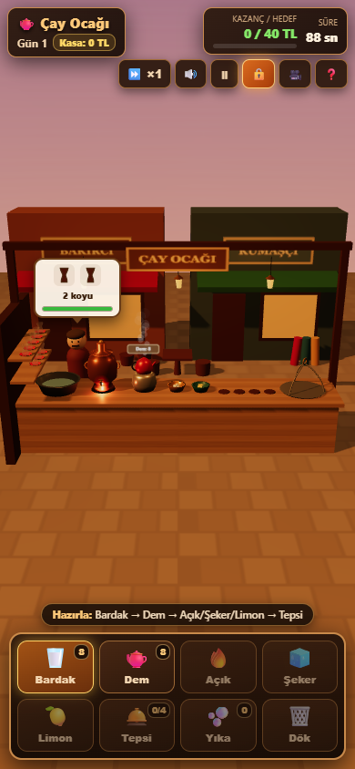
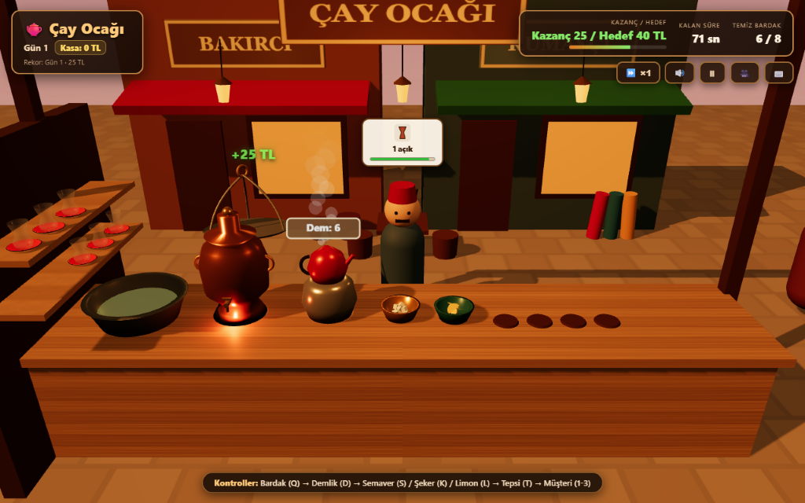

# 🫖 Çay Ocağı — 3D Çarşı İşletme Oyunu (Mobil & PC)

Geleneksel Türk çarşısında kendi çay ocağını işlet! İnce belli bardaklara taze dem koy, semaverle açık çay hazırla, şeker ve taze limon ekle, askılı tepsiyle esnafa yetiştir ve kazancınla dükkânını büyüt.

---

## ▶️ Hemen Oyna (Mobil & Masaüstü)

### 👉 **[CANLI OYUNU AÇ — https://merakediyoruzcom.github.io/cay-ocagi/](https://merakediyoruzcom.github.io/cay-ocagi/)**

> 📱 **Telefondan Uygulama Gibi Oynamak İçin:** Yukarıdaki bağlantıyı telefon tarayıcısında (Chrome / Safari) açıp **"Ana Ekrana Ekle"** seçeneğine dokunman yeterli — tam ekran mobil oyun (PWA) olarak çalışır!

---

## 📸 Ekran Görüntüleri

| 📱 Mobil Sürüm (Tek El / Başparmak Paneli) | 🖥️ Masaüstü 3D Çarşı Görünümü |
| :---: | :---: |
|  |  |

---

## ✨ Öne Çıkan Özellikler

- **📱 Mobil-Öncelikli Tek El Kontrolü:** Ekranın altındaki **4×2 başparmak paneli** ile küçük 3D nesnelere nişan almadan tek dokunuşla bardak al, dem dök, açık yap, şeker/limon ekle, tepsiye diz ve yıka.
- **🛎️ Tek Dokunuşla Yeşil `TESLİM ET` Düğmesi:** Tepsin bekleyen müşterinin siparişiyle eşleştiği anda başparmağının hemen üstünde parlak yeşil teslim düğmesi açılır.
- **🔒 Akıllı Mobil Kamera & Kamera Kilidi:** Telefon dikey/yatay ekranına göre 3D kamera otomatik hizalanır; kamera kilidi açık geldiği için hızlı oynarken görüntü kaymaz.
- **🍋 Zengin Menü & Özel Müşteriler:** Koyu/açık çay, küp şeker, **limonlu çay (+3 TL)**; 2. günden itibaren **👑 Müdavim (VIP)** (2x bahşiş + 8 TL) ve **⚡ Aceleci Esnaf** (+10 TL hız primi).
- **🔥 Seri (Kombo) Sistemi:** Ardışık hızlı teslimatlarda `2x` seriden itibaren **+3 TL → +15 TL** ek seri bonusu.
- **🏪 5 Kalıcı Dükkân Yükseltmesi:** Gün sonlarında biriken **Kasa** ile *Bakır Turbo Demlik*, *Yalıtımlı Semaver*, *Sıcak Su Tesisatı*, *Usta Askılı Tepsi (6 bardak + 10 raf)* ve *Altın Yaldızlı Set* satın alınabilir.
- **♾️ Sonsuz Çarşı Modu & Rekor Kaydı:** 3 günlük kampanyayı bitirip **Usta Çaycı** olduktan sonra **Gün 4+** sonsuz modda rekor kırabilirsin (`localStorage` ile kaydedilir).
- **🔊 Harici Dosyasız Prosedürel Sesler:** Web Audio API ile çay dökülme, semaver suyu, bardak/kaşık şıngırtısı, yıkama köpüğü, kapı zili ve para sesleri.

---

## 🎮 Nasıl Oynanır?

### 📱 Mobil (Dokunmatik Başparmak Paneli)
1. **🥛 Bardak:** Raftan temiz ince belli bardak alır.
2. **🫖 Dem / Demle!:** Bardağa koyu dem doldurur; dem bittiğinde veya bayatladığında tek dokunuşla taze çay demler.
3. **🔥 Açık:** Semaverden sıcak su ekleyip çayı açık yapar.
4. **🧊 Şeker / 🍋 Limon:** İsteğe göre küp şeker ve taze limon dilimi ekler.
5. **🛎️ Tepsi:** Hazır bardağı askılı tepsiye yerleştirir.
6. **🛎️ TESLİM ET:** Sipariş eşleşince çıkan yeşil düğmeye (veya yeşil parlayan müşteriye) dokun!
7. **🫧 Yıka / 🗑️ Dök:** Kirli bardakları tek dokunuşla yıkar veya hatalı bardağı döker.

### 🖥️ Bilgisayar (Fare + Klavye Kısayolları)
| Tuş | İşlev | Tuş | İşlev |
| :---: | :--- | :---: | :--- |
| `Q` | Raftan bardak al | `T` | Tepsiye koy |
| `D` | Demlik (Doldur / Demle) | `Y` | Leğen (Yıka / Dök) |
| `S` | Semaver (Açık yap) | `1` `2` `3` | 1–3. müşteriye teslim et |
| `K` | Şekerlik (+Şeker) | `Boşluk` | Hız (`×1 / ×2 / ×4`) |
| `L` | Limonluk (+Limon) | `P` / `M` / `C` | Duraklat / Ses / Kamera sıfırla |

---

## 🧪 Öz-Testler (`#selftest`)

Oyun çekirdeği Three.js ve DOM'dan tamamen bağımsız, deterministik saf JavaScript olarak yazılmıştır. Tüm **16 otomatik testi** tarayıcı konsolunda çalıştırmak için canlı adresin sonuna `#selftest` eklemen yeterlidir:

```
https://merakediyoruzcom.github.io/cay-ocagi/#selftest
```
